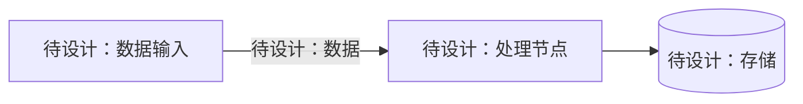
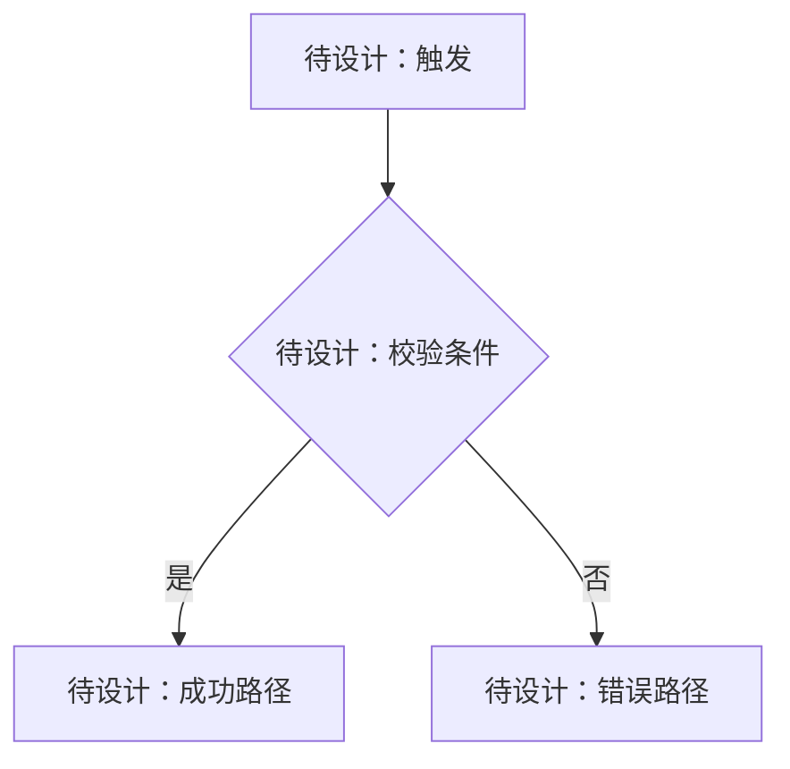
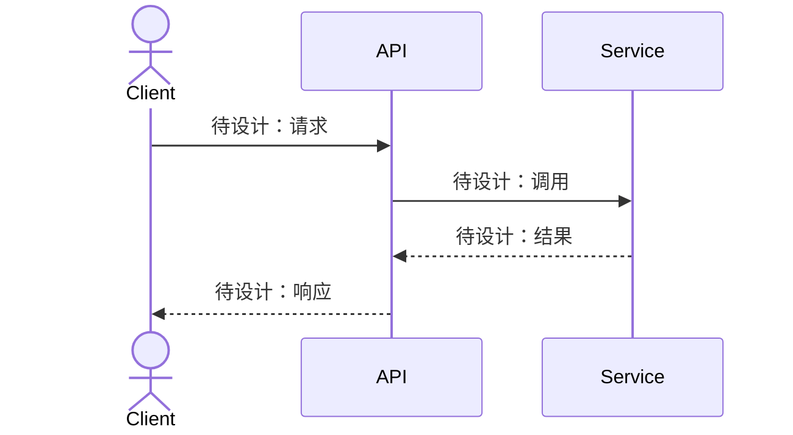

# 后端技术设计｜{{PROJECT_ID}}

> 版本：`草稿 v0.1`；审批状态：`NOT_APPROVED`；依据需求版本：[待填写]；范围：[待填写]。

## 1. 设计目标、边界与需求映射

- 设计目标：[待填写]
- 不做事项：[待填写]
- 覆盖 REQ-ID：[待填写]
- 验收口径：[待填写]

## 2. 当前仓库技术现状与证据

| 项目 | 已验证事实（如有） | 代码文件/配置路径 | 不确定项 |
|---|---|---|---|
| 语言、框架、数据库方言 | [待核实] | [待核实] | [待核实] |
| 代码分层、统一响应/异常 | [待核实] | [待核实] | [待核实] |
| 已有接口与复用点 | [待核实] | [待核实] | [待核实] |

## 3. 模块总体设计与职责

| 模块 | 职责 | 输入 | 输出 | 依赖 | 一致性/鉴权边界 |
|---|---|---|---|---|---|
| [待填写] | [待填写] | [待填写] | [待填写] | [待填写] | [待填写] |

## 4. API 合约设计

| API-ID | REQ-ID | 模块 | 新建/修改 | 方法 | 路径 | 鉴权 | DTO 入参/校验 | VO/响应 | 错误码 | 事务与幂等 |
|---|---|---|---|---|---|---|---|---|---|---|
| API-001 | [待填写] | [待填写] | [待填写] | [待核实] | [待核实] | [待填写] | [待填写] | [待填写] | [待填写] | [待填写] |

## 5. 数据流图

<!-- 在批准前删除占位节点，替换为真实的调用方、服务、存储、下游及数据名称 -->


## 6. 功能流程图

<!-- 在批准前将条件、异常分支和事务结果替换为具体业务规则 -->


## 7. 时序图

<!-- 在批准前体现实际 API、Service、DAO/外部依赖、事务边界和异常路径 -->


## 8. 数据模型、数据库 DDL 与迁移

- 数据库产品/版本/方言：[待核实]
- 表/字段改动：[待确认]；**若确定无数据库变化，请明确填写“无 DDL 变更”**。
- DDL 执行权限：未授权，本文 SQL 仅供评审。

```sql
-- 待设计：仅在确有表结构改动且方言已确认时填写完整 DDL
-- 字段含义/枚举值/索引依据/迁移回滚策略不可省略
```

- 字段字典（类型、NULL、默认值、业务语义、枚举、单位）：[待填写/无]
- 迁移及上线顺序（含幂等策略）：[待填写/无]
- 兼容性与回滚：[待填写/无]

## 9. 核心实现逻辑与伪代码

| REQ-ID | 触发 | 校验/算法/并发处理 | 事务边界 | 失败/补偿 | 幂等策略 |
|---|---|---|---|---|---|
| [待填写] | [待填写] | [待填写] | [待填写] | [待填写] | [待填写] |

## 10. 技术难点与方案权衡

| 难点 | 方案 A（利弊） | 方案 B（利弊） | 选择及理由 | 约束/待验证项 |
|---|---|---|---|---|
| [待填写或无需专项选型] | [待填写] | [待填写] | [待填写] | [待填写] |

## 11. 安全、性能、可观测性、兼容性

- 身份验证/授权/数据脱敏：[待填写]
- 并发、幂等、一致性：[待填写]
- 超时、重试、失败补偿：[待填写]
- 性能预估、索引与监控：[待填写]
- 灰度发布及回滚：[待填写]

## 12. 实施依赖顺序与测试策略

| 顺序 | 模块 | 前置 | 验证目标 | 风险 |
|---|---|---|---|---|
| [待填写] | [待填写] | [待填写] | [待填写] | [待填写] |

## 13. 未决问题、风险及审批

- 未决 Q-ID：[待填写或无]
- 风险与缓解：[待填写]
- 审批状态：NOT_APPROVED
- 需用户审批的版本/范围：草稿 v0.1 / [待填写]
