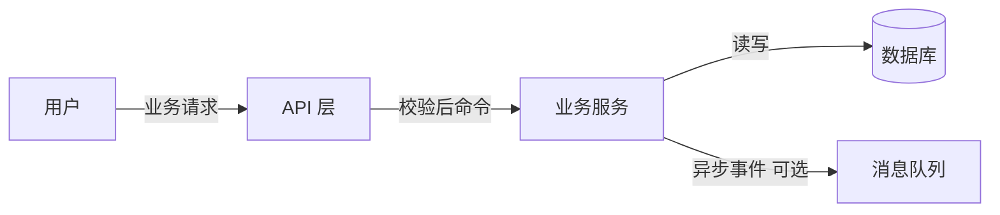
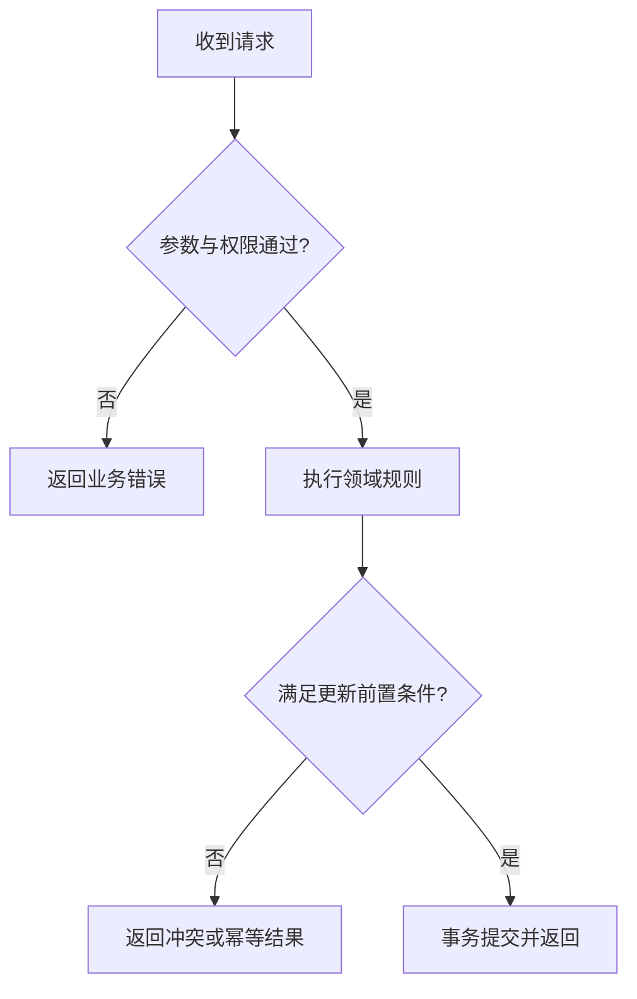
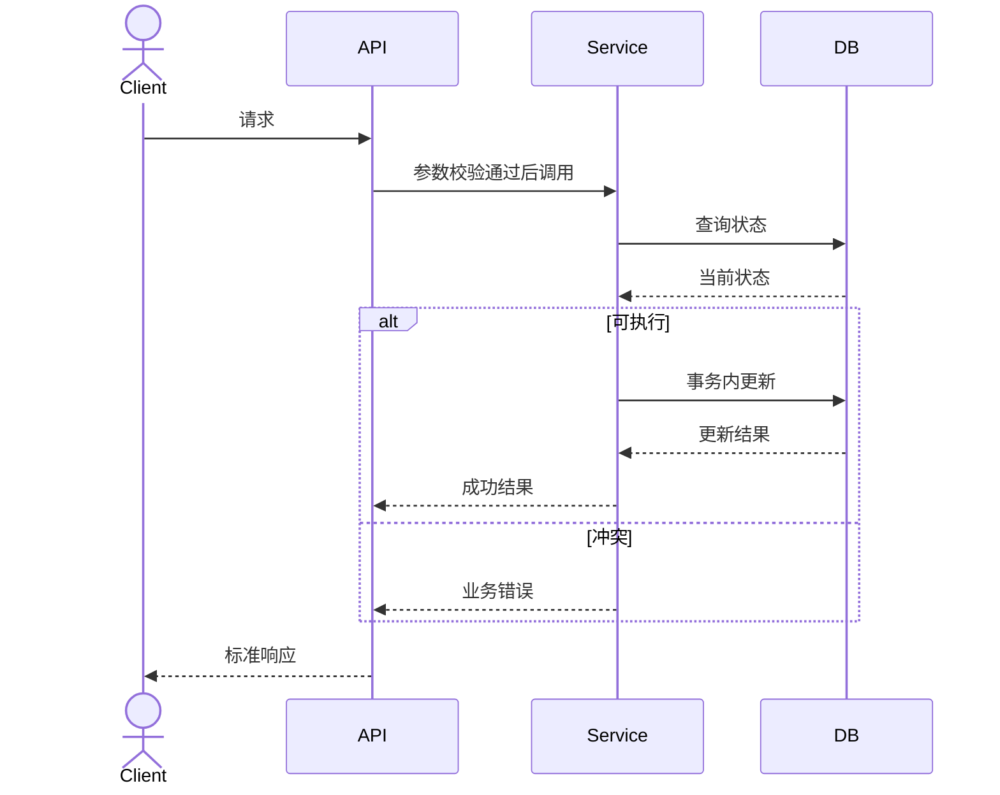

# 技术方案设计指南

## 先核实仓库

优先检查：语言/构建系统（如 Maven/Gradle）、模块组织、controller/service/DAO 分层、DTO/VO/Entity/Mapper 的实际位置、统一响应体/异常处理/错误码、鉴权、事务、分页/排序、MyBatis/JPA、环境配置、数据库方言和版本、已有表/索引/SQL 迁移方式、缓存/MQ/任务机制、已有测试形式和 CI。

记录已阅读的真实文件路径/类名/关键方法，区分“已验证现状”和“拟新增”；对未连接的 DB 表结构标待验证。不得因仓库命名猜测业务含义。

## 技术方案应覆盖

1. 需求与边界：目标、不做事项、模块统计、优先级、依赖和验收标准。
2. 当前架构与复用点：代码位置、接口、依赖和技术栈事实与引用依据。
3. 总体设计：组件职责、数据模型、主读写链路、接口表（方法+路径+鉴权+入参/出参+错误码+幂等/分页/事务）；区分新建/变更/复用。
4. **数据流图**（Mermaid `flowchart LR`）：外部触发者→接口→服务→存储/下游及数据名称、失败路径。
5. **功能流程图**（Mermaid `flowchart TD`）：条件分支、校验失败、幂等、边界/回滚；体现实际业务决定。
6. **时序图**（Mermaid `sequenceDiagram`）：真实交互方、主要调用、关键数据库查询/更新、错误处理及事务边界。
7. **DDL/数据迁移**：针对已确认方言，完整注释（字段含义、枚举全部值、单位、NULL 约束与默认值），主键、唯一键、索引与性能依据；涉及存量数据则设计安全幂等迁移、灰度兼容、回滚。DDL 未定稿的字段写待确认，不编造名称。
8. **难点选型**：比较至少 2 种有意义的替代方案，给出权衡（性能、复杂性、一致性、运维、回滚）及推荐前置条件；不需要选型的普通 CRUD 不强行编造选项。
9. **非功能设计**：权限、数据泄漏风险、并发、幂等、事务边界、数据一致性、限流/容量、日志追踪、容错、监控及兼容性（按需求风险选择）。
10. **质量与发布**：模块测试/集成/回归计划、环境与样例准备、兼容性验证、部署顺序/回滚和开放问题清单。

## 示例图（仅供语法参考，必须换成真实业务）

**注意**：以上只有占位示例；任何未包含实际业务语义的图都不能视为完成。`sequenceDiagram` 不保证映射实际事务，仅用于表示交互；真实方案应写清操作的事务和一致性界限。

## DDL 检查

- 首先确认方言与版本，Oracle/MySQL/其他不可相互套用 `COMMENT` 或自增语法。
- 对字段命名、精度（金额与时间）、字符集/排序规则、时区、软删及逻辑唯一性进行核对。
- 唯一键、索引和约束需对应查询条件与业务唯一性。
- 每个枚举字段按用户项目约定解释全部数值，如 `0=是/1=否`，绝不靠直觉假定 `0=否`。
- 删除/改字段与数据回填须说明线上风险、锁表、批量策略、回退与数据备份；未经授权不执行。
